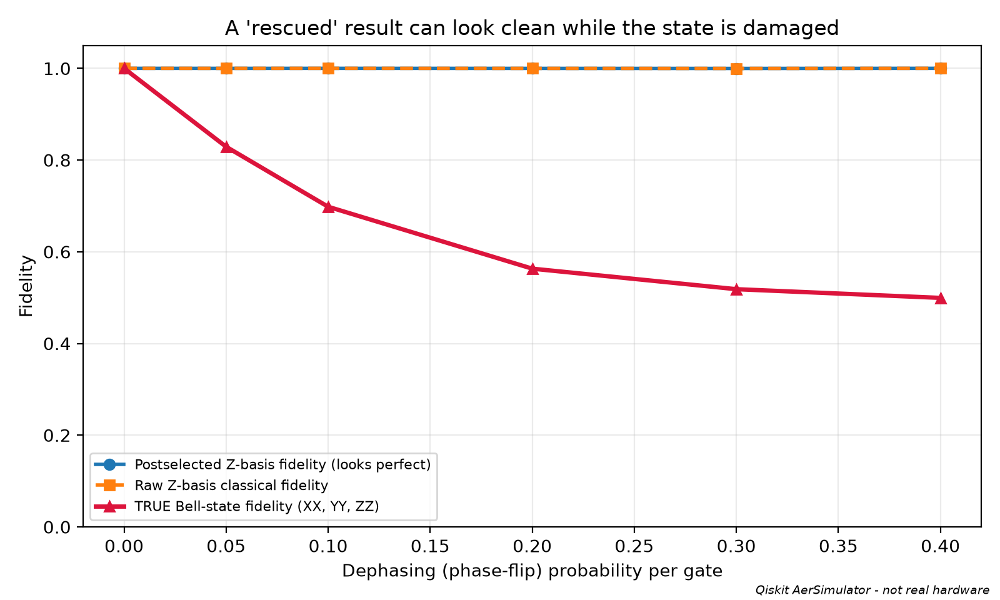
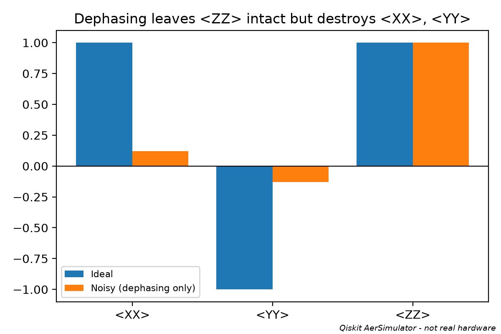
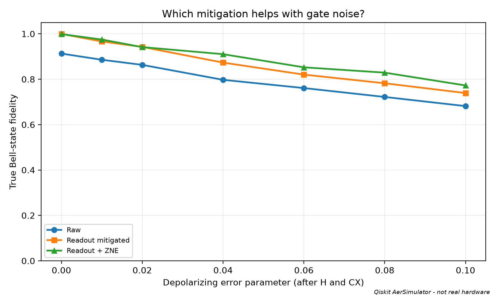

# Quantum Rescue: Cleaning Up a Quantum Result Is Not Recovering It

**IBM Qiskit Fall Fest 2026 · RV University · 24-hour hackathon**

> **All results in this repository come from a local Qiskit `AerSimulator`. Nothing was run on real quantum hardware.**

## Team

| Member |
|---|---|
| Nikhil Eshwar R | 
| Harsha Prakash Patel |
| Nanda Kishore A | 

## One-sentence finding

A noisy Bell-state result can be "cleaned up" until it looks perfect while the quantum state is still badly damaged: in our simulation, parity postselection reported a Z-basis fidelity of **1.000** while the true Bell-state fidelity was **0.563**.

## Why we chose this

Most quantum demos show that something works. We wanted to ask the opposite question: **can we trust the answer a noisy quantum computer gives us?** We add noise to the simplest entangled circuit, then compare three ways of "rescuing" the result, measuring what each one fixes, what it misses, and what it costs.

## The concept in brief

The circuit prepares the Bell state `|Φ+> = (|00> + |11>)/√2` with a Hadamard and a CNOT. Ideally, measuring both qubits in the Z basis gives `00` or `11`, each half the time.

The catch: **Z-basis counts only reveal one correlation (ZZ).** A state can have perfect ZZ correlation and still not be entangled. The true fidelity with `|Φ+>` is

```
F = (1 + <XX> - <YY> + <ZZ>) / 4
```

so we also measure the same state in the X basis (rotate with `Ry(-π/2)`) and Y basis (rotate with `Rx(π/2)`) before measuring. `F = 1` is a perfect Bell state; `F = 0.5` is a purely classical mixture of `00` and `11`.

## What we built

**Three noise sources** (all in `bell_fidelity.py`, using `qiskit_aer.noise`):
- **Depolarizing noise** after the H and CX gates
- **Dephasing (phase-flip) noise** after the H and CX gates: invisible when measuring in Z
- **Readout error**: each measured bit flips with a fixed probability

**Three rescue strategies**, compared on cost (4,000 shots per circuit):

| Strategy | What it does | Circuits | Total shots |
|---|---|---|---|
| Parity postselection | Keep only `00`/`11` outcomes in the Z-basis run | 1 | 4,000 |
| Readout mitigation | Calibrate a 4×4 assignment matrix, then invert it (negatives clipped, renormalized) | 3 + 4 calibration | 20,000 |
| Readout mitigation + ZNE | Also fold each CX into CX·CX·CX (1×, 3×, 5× gate noise), then extrapolate linearly back to zero noise | 9 + 4 calibration | 44,000 |

For comparison, one un-mitigated measurement of all three bases uses 3 circuits and 12,000 shots.

## Results

All numbers below are from one seeded run of `python run_demo.py` (4,000 shots per circuit, seeds fixed in the code). Exact values are in `results/*.csv`; correlators are rounded to 2 decimals.

### Finding 1: postselection can look perfect while the state is wrong (dephasing only, no readout error)


*Qiskit AerSimulator, not real hardware.*

| Dephasing p | `<XX>` | `<YY>` | `<ZZ>` | Postselected Z-basis fidelity | Shots kept | **True Bell fidelity** |
|---|---|---|---|---|---|---|
| 0.00 | 1.00 | -1.00 | 1.00 | 1.000 | 100% | 1.000 |
| 0.05 | 0.66 | -0.66 | 1.00 | 1.000 | 100% | 0.829 |
| 0.10 | 0.38 | -0.41 | 1.00 | 1.000 | 100% | 0.698 |
| 0.20 | 0.12 | -0.13 | 1.00 | 1.000 | 100% | **0.563** |
| 0.30 | 0.02 | -0.05 | 1.00 | 1.000 | 100% | 0.518 |
| 0.40 | -0.01 | -0.01 | 1.00 | 1.000 | 100% | 0.499 |

Phase errors do not change Z-basis outcomes, so `<ZZ>` stays at 1.00, no shots are discarded, and the Z-basis data looks perfect. But `<XX>` and `<YY>` collapse to zero, and the fidelity falls to 0.5, the value for a state with no entanglement.



### Finding 2: only some strategies touch gate noise (depolarizing noise, readout flip 3%)


*Qiskit AerSimulator, not real hardware.*

| Depolarizing p | Z-basis fidelity (raw) | Z-basis fidelity (postselected) | True fidelity (raw) | + Readout mitigation | + ZNE |
|---|---|---|---|---|---|
| 0.00 | 0.943 | 1.000 | 0.913 | 1.000 | 0.999 |
| 0.01 | 0.939 | 1.000 | 0.886 | 0.967 | 0.975 |
| 0.02 | 0.930 | 1.000 | 0.863 | 0.942 | 0.942 |
| 0.04 | 0.917 | 1.000 | 0.797 | 0.873 | 0.910 |
| 0.06 | 0.910 | 1.000 | 0.761 | 0.820 | 0.853 |
| 0.08 | 0.909 | 1.000 | 0.722 | 0.782 | 0.829 |
| 0.10 | 0.904 | 1.000 | 0.682 | 0.739 | 0.773 |

- **Postselection** again reports about 1.000 at every noise level, while the true fidelity falls to 0.68. (It keeps 90-94% of shots.)
- **Readout mitigation** removes the readout part of the error: at p = 0 it takes the fidelity from 0.913 to 1.000, and it adds roughly +0.06 to +0.08 everywhere else. It cannot fix gate noise.
- **ZNE** adds roughly another +0.03 to +0.05 once gate noise is significant (p ≥ 0.04), at more than double the shot cost of readout mitigation. At p ≤ 0.02 it is no better than readout mitigation within the noise of this experiment.
- **Nothing fully recovers the ideal state**: at p = 0.10 the best result is 0.773.

### Circuit diagrams

`results/circuit_Z.png`, `results/circuit_X.png` and `results/circuit_Y.png` show the Bell circuit with each measurement basis. Text versions are in `results/circuit_*.txt`.

## What the results mean

1. **A good-looking histogram is not evidence of a good state.** Checking one basis cannot catch errors that live in another basis.
2. **Each mitigation fixes one kind of error.** Postselection sees only errors that flip Z-basis parity, readout mitigation fixes only measurement error, and ZNE helps with some gate noise.
3. **Every method has a price**: discarded data, calibration circuits, or many more circuits and shots.

## Limitations and what we learned

- **Simulator only.** Real devices have drifting, correlated, gate-dependent noise that our simple models do not capture.
- **Mitigation is flattered by the simulation.** We calibrate readout mitigation using the same error model that corrupts the data, so the calibration matches the true readout noise by construction. On hardware it would not.
- **Single seeded run, no error bars.** Each correlator comes from 4,000 shots, so fidelities carry statistical noise of roughly 0.01, more after extrapolation. We do not claim differences smaller than about 0.02 (for example ZNE vs. readout mitigation at p ≤ 0.02). The Streamlit app's repeated-trials study only covers the Z-basis metric.
- **ZNE is partial.** We fold only CX gates, so single-qubit H noise is not extrapolated away. We use a simple linear fit, which can over- or under-shoot.
- **Noiseless basis rotations.** The `Ry`/`Rx` gates that change the measurement basis are noise-free in our model; on hardware they would add error.
- **This is error mitigation, not error correction.** We never protect the state; we only estimate a cleaner answer from noisy runs.
- **Biggest lesson:** the metric you choose decides what you can detect. Our original Z-basis "fidelity" hid exactly the errors that mattered.
- **Next steps:** repeat over many seeds with confidence intervals; run with a real IBM backend's noise snapshot, then on hardware; try other extrapolation fits; add noisy basis rotations.

## Setup and run

Tested with Python 3.13, `qiskit` 2.6.0 and `qiskit-aer` 0.17.2 on Windows. Exact pinned versions are in `requirements.txt`.

```powershell
py -m venv .venv
.venv\Scripts\activate
python -m pip install -r requirements.txt
python run_demo.py        # writes charts, circuits and CSVs to results/
python -m pytest -q       # 10 tests
```

Optional interactive explorer (older Z-basis dashboard; the main results come from `run_demo.py`):

```powershell
streamlit run app.py
```

`pylatexenc` is optional. Without it, circuit diagrams are drawn from their text form instead of the Qiskit matplotlib style.

## Repository layout

| File | Purpose |
|---|---|
| `run_demo.py` | One-command demo: runs both experiments and writes everything in `results/` |
| `bell_fidelity.py` | True Bell fidelity (X/Y/Z bases), dephasing/depolarizing/readout noise, readout mitigation, ZNE |
| `quantum_engine.py` | Bell circuit, readout calibration and mitigation helpers, Z-basis metrics |
| `app.py` | Optional Streamlit dashboard (Z-basis view) |
| `tests/` | Automated checks (`pytest.ini` points pytest at the project root) |
| `results/` | Charts, circuit diagrams, CSV tables (all simulator output) |

## Sources, reuse and AI assistance

- IBM Quantum, [Qiskit documentation](https://quantum.cloud.ibm.com/docs/).
- Qiskit Aer, [Building noise models](https://qiskit.github.io/qiskit-aer/tutorials/3_building_noise_models.html), used for the `NoiseModel`, `depolarizing_error`, `pauli_error` and `ReadoutError` APIs.
- Qiskit Experiments, [Readout mitigation](https://github.com/qiskit-community/qiskit-experiments/blob/main/docs/manuals/measurement/readout_mitigation.rst), used for the concept only. We implemented the calibration-matrix inversion ourselves with NumPy.
- Zero-noise extrapolation concept: Temme, Bravyi, Gambetta, "Error mitigation for short-depth quantum circuits," *Phys. Rev. Lett.* 119, 180509 (2017); Li and Benjamin, *Phys. Rev. X* 7, 021050 (2017). The implementation (CX folding and linear fit) is our own.
- The Bell-state fidelity formula `F = (1 + XX - YY + ZZ)/4` is standard.

**What we changed or added on top of the starting dashboard:** true-fidelity measurement in three bases, the dephasing noise model, CX-folding ZNE, the one-command `run_demo.py`, the cost comparison, the tests, and the "postselection can fool you" experiment.

**AI assistance:** we used Claude (Anthropic) as an AI assistant during the hackathon to help plan experiments and draft code and documentation. We ran, tested and reviewed everything ourselves.
